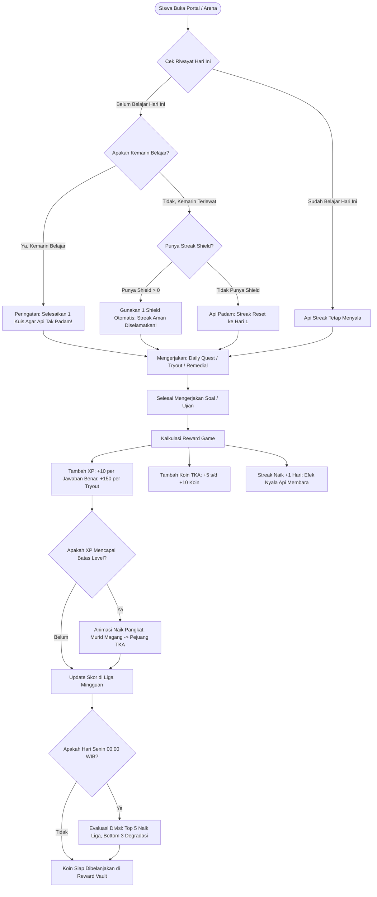
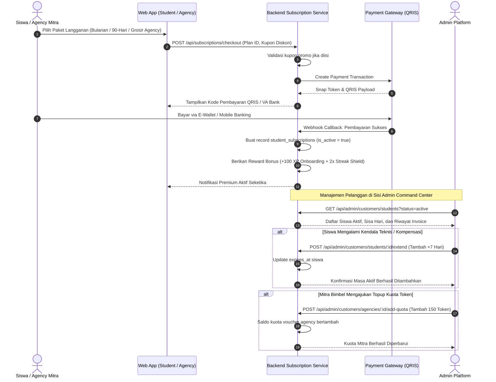
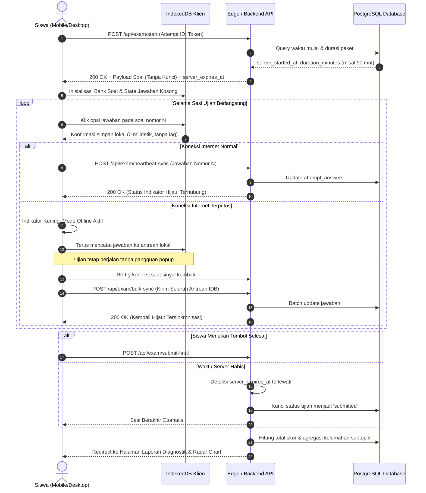
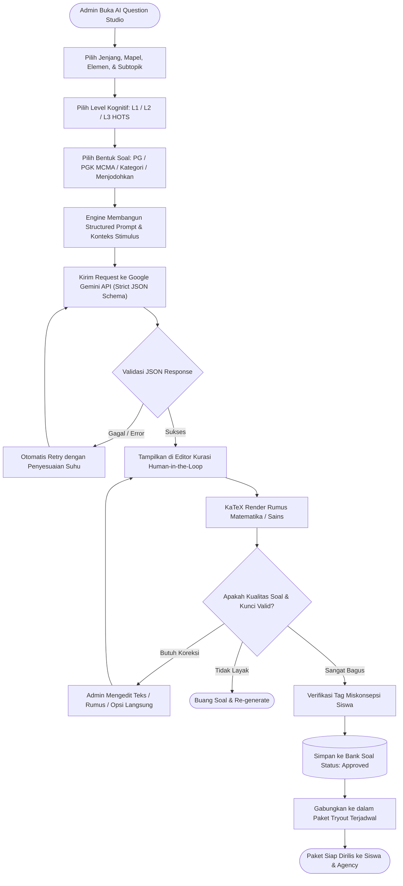

# Diagram Sistem & Arsitektur (Mermaid): CBT TKA Online

> **Status:** Diagram Spesifikasi Teknis (Versi 2.0)  
> **Cakupan:** Arsitektur Sistem, ERD Lengkap (Langganan & Gamifikasi), State Machine CBT, Gamification Loop Engine, Siklus Langganan, dan Alur AI Question Studio  

---

## 1. Arsitektur Sistem Keseluruhan (System Architecture)

```mermaid
flowchart TB
    subgraph KLIEN["Perangkat Klien (Web & Mobile Browser)"]
        UI_STUDENT["Portal Siswa (Mobile-First / Dual Mode)"]
        UI_GAMIFY["Arena Gamifikasi Gen Z (Streak & Quests)"]
        UI_AGENCY["Dasbor Agency / Bimbel Mitra"]
        UI_ADMIN["Admin Command Center & AI Studio"]
        IDB[("IndexedDB Lokal (Cache Jawaban & Token)")]
        UI_STUDENT <--> IDB
        UI_GAMIFY <--> UI_STUDENT
    end

    subgraph CDN_EDGE["Edge Network & Security Layer"]
        WAF["Web Application Firewall & DDOS Shield"]
        STATIC_CDN["CDN Aset Statis (KaTeX, SVG Icons)"]
    end

    subgraph BACKEND["Backend & API Services (Node.js / Edge Functions)"]
        AUTH_SVC["Authentication & RBAC Service"]
        EXAM_ENGINE["CBT Attempt & Time Authority Engine"]
        GAMIFY_ENGINE["Gen Z Gamification & Streak Engine"]
        LEAGUE_CRON["Weekly League & Division Worker"]
        SUB_SVC["Subscription & Customer Management Service"]
        SYNC_SVC["Background Queue Sync Service"]
        DIAG_ENGINE["Smart Diagnostic & Radar Chart Service"]
        AGENCY_SVC["Agency Quota & Voucher Service"]
        PAYMENT_SVC["Payment Gateway Webhook Service"]
        AI_GATEWAY["AI Orchestrator (Prompt Pipeline)"]
    end

    subgraph EKSTERNAL["Layanan Pihak Ketiga"]
        GEMINI_API["Google Gemini 2.5 Flash / Pro API"]
        PG_MIDTRANS["Payment Gateway (QRIS, VA Bank)"]
    end

    subgraph DATABASE["Database Utama (PostgreSQL / Neon / Supabase)"]
        DB_USERS[(Tabel Users & Profil)]
        DB_SUBS[(Tabel Langganan & Kupon)]
        DB_GAMIFY[(Tabel Streak, XP, Quests)]
        DB_QUESTIONS[(Tabel Bank Soal & Stimulus)]
        DB_PACKAGES[(Tabel Paket & Blueprint)]
        DB_ATTEMPTS[(Tabel Sesi Ujian & Jawaban)]
        DB_VOUCHERS[(Tabel Voucher Agency)]
        DB_ANALYTICS[(Tabel Diagnostik Kelemahan)]
    end

    UI_STUDENT --> WAF
    UI_GAMIFY --> WAF
    UI_AGENCY --> WAF
    UI_ADMIN --> WAF
    WAF --> STATIC_CDN
    WAF --> AUTH_SVC
    WAF --> EXAM_ENGINE
    WAF --> GAMIFY_ENGINE
    WAF --> SUB_SVC
    WAF --> SYNC_SVC
    WAF --> DIAG_ENGINE
    WAF --> AGENCY_SVC

    EXAM_ENGINE <--> DB_ATTEMPTS
    EXAM_ENGINE <--> DB_QUESTIONS
    GAMIFY_ENGINE <--> DB_GAMIFY
    LEAGUE_CRON --> DB_GAMIFY
    SUB_SVC <--> DB_SUBS
    SYNC_SVC --> DB_ATTEMPTS
    DIAG_ENGINE --> DB_ANALYTICS
    AGENCY_SVC <--> DB_VOUCHERS
    AUTH_SVC <--> DB_USERS
    PAYMENT_SVC <--> PG_MIDTRANS
    PAYMENT_SVC --> SUB_SVC
    PAYMENT_SVC --> AGENCY_SVC

    UI_ADMIN --> AI_GATEWAY
    AI_GATEWAY <--> GEMINI_API
    AI_GATEWAY --> DB_QUESTIONS
```

---

## 2. Diagram Hubungan Entitas Lengkap (Enhanced ERD)

```mermaid
erDiagram
    USERS ||--o{ STUDENT_SUBSCRIPTIONS : "memiliki_langganan"
    USERS ||--|| STUDENT_GAMIFICATION : "memiliki_progres_game"
    USERS ||--o{ STUDENT_DAILY_QUESTS : "mengerjakan_misi"
    USERS ||--o{ AGENCIES : "dimiliki_oleh"
    USERS ||--o{ EXAM_ATTEMPTS : "mengerjakan_ujian"
    USERS ||--o{ VOUCHERS : "meredeem_voucher"

    AGENCIES ||--o{ VOUCHERS : "menerbitkan_voucher"
    AGENCIES ||--o{ AGENCY_TRANSACTIONS : "transaksi_kuota"
    
    PRICING_PLANS ||--o{ STUDENT_SUBSCRIPTIONS : "paket_rujukan"
    DISCOUNT_COUPONS ||--o{ STUDENT_SUBSCRIPTIONS : "diskon_diterapkan"

    PACKAGES ||--o{ PACKAGE_QUESTIONS : "berisi_soal"
    QUESTIONS ||--o{ PACKAGE_QUESTIONS : "dimasukkan_ke"
    PACKAGES ||--o{ EXAM_ATTEMPTS : "paket_yang_diuji"
    PACKAGES ||--o{ VOUCHERS : "terkait_dengan_paket"

    EXAM_ATTEMPTS ||--o{ ATTEMPT_ANSWERS : "memiliki_jawaban"
    QUESTIONS ||--o{ ATTEMPT_ANSWERS : "butir_soal"
    EXAM_ATTEMPTS ||--o{ DIAGNOSTIC_REPORTS : "menghasilkan_diagnostik"
    DIAGNOSTIC_REPORTS ||--o{ REMEDIAL_DRILLS : "memicu_remedial"

    USERS {
        uuid id PK
        varchar email
        varchar phone
        varchar full_name
        varchar role "admin | agency | student"
        varchar target_jenjang "SD | SMP | SMA"
        timestamp created_at
        timestamp updated_at
    }

    STUDENT_SUBSCRIPTIONS {
        uuid id PK
        uuid user_id FK
        uuid pricing_plan_id FK
        varchar plan_code "monthly | 90_days | single_token"
        timestamp starts_at
        timestamp expires_at
        boolean is_active
        integer remedial_quota_left "kuota drill AI bulanan"
        decimal amount_paid_idr
        varchar payment_status "pending | paid | expired"
        varchar payment_ref
        timestamp created_at
    }

    PRICING_PLANS {
        uuid id PK
        varchar plan_category "student_retail | agency_wholesale | agency_saas"
        varchar plan_code UK
        varchar title
        integer duration_days
        decimal price_idr
        integer token_quota "jumlah token jika paket grosir"
        boolean is_active
        timestamp created_at
    }

    DISCOUNT_COUPONS {
        uuid id PK
        varchar code UK
        decimal discount_percent
        integer max_usage
        integer used_count
        timestamp expires_at
        boolean is_active
    }

    STUDENT_GAMIFICATION {
        uuid id PK
        uuid user_id FK
        integer streak_count "jumlah hari berturut-turut api belajar"
        date last_activity_date
        integer streak_shields_count "stok pelindung api"
        integer xp_total "total poin pengalaman"
        integer current_level "1 s/d 50+"
        varchar rank_title "Murid Magang | Pejuang TKA | Master"
        integer coins_balance "saldo koin untuk reward"
        varchar current_league "bronze | silver | gold | diamond | mythic"
        integer weekly_xp "xp terkumpul dalam minggu berjalan"
        varchar dream_school_target "sekolah impian siswa"
        decimal dream_target_score "target passing grade"
        timestamp updated_at
    }

    STUDENT_DAILY_QUESTS {
        uuid id PK
        uuid user_id FK
        date quest_date
        varchar quest_type "warmup | review_error | blitz"
        varchar quest_title
        integer current_progress
        integer target_progress
        boolean is_completed
        boolean is_claimed
        integer reward_xp
        integer reward_coins
    }

    AGENCIES {
        uuid id PK
        uuid user_id FK
        varchar agency_name
        varchar slug UK "unik untuk portal co-branded"
        varchar logo_url
        varchar phone_contact
        integer quota_balance "sisa token siswa"
        varchar saas_status "active | grace_period | expired"
        timestamp saas_expires_at
        decimal commission_rate
        timestamp created_at
    }

    QUESTIONS {
        uuid id PK
        varchar level_jenjang "SD | SMP | SMA"
        varchar subject
        varchar element "Domain materi"
        varchar subtopic "Subdomain materi"
        varchar cognitive_level "L1 | L2 | L3"
        varchar format_type "single_choice | mcma | category | matching | short_answer"
        text stimulus_text
        text question_text
        jsonb options_payload
        jsonb correct_answer_payload
        text explanation_text
        jsonb misconception_tags
        varchar status "draft | review | approved"
        timestamp created_at
    }

    PACKAGES {
        uuid id PK
        varchar title
        varchar level_jenjang
        varchar subject
        integer duration_minutes
        integer total_questions
        boolean is_free
        decimal price_idr
        jsonb blueprint_composition
        boolean is_active
    }

    PACKAGE_QUESTIONS {
        uuid id PK
        uuid package_id FK
        uuid question_id FK
        integer question_order
        decimal weight_score
    }

    VOUCHERS {
        uuid id PK
        uuid agency_id FK
        uuid package_id FK
        varchar voucher_code UK
        varchar batch_name
        boolean is_redeemed
        uuid redeemed_by_user_id FK
        timestamp redeemed_at
    }

    EXAM_ATTEMPTS {
        uuid id PK
        uuid user_id FK
        uuid package_id FK
        timestamp server_started_at
        timestamp server_expires_at
        timestamp submitted_at
        decimal total_score
        integer violation_count
        varchar status "in_progress | submitted | expired"
        jsonb subtopic_summary
    }

    ATTEMPT_ANSWERS {
        uuid id PK
        uuid attempt_id FK
        uuid question_id FK
        jsonb student_answer
        boolean is_doubtful
        boolean is_correct
        decimal score_obtained
        timestamp last_updated_at
    }

    DIAGNOSTIC_REPORTS {
        uuid id PK
        uuid attempt_id FK
        uuid user_id FK
        jsonb radar_chart_points
        varchar primary_weakness_subtopic
        text ai_diagnostic_narrative
        timestamp created_at
    }

    REMEDIAL_DRILLS {
        uuid id PK
        uuid diagnostic_report_id FK
        uuid user_id FK
        varchar subtopic_target
        jsonb drill_questions_payload
        decimal drill_score
        timestamp completed_at
    }

    AGENCY_TRANSACTIONS {
        uuid id PK
        uuid agency_id FK
        integer tokens_purchased
        decimal total_amount_idr
        varchar payment_method
        varchar payment_status
        timestamp paid_at
    }
```

---

## 3. Siklus Gamifikasi Siswa POV Gen Z (Daily Streak & Quests Engine)

---

## 4. Alur Pembelian & Pengelolaan Langganan (Subscription Lifecycle)

---

## 5. Diagram Urutan: Sesi Ujian Siswa dengan Sinkronisasi Tangguh

---

## 6. Diagram Alur: AI Question Production Studio (Admin)

